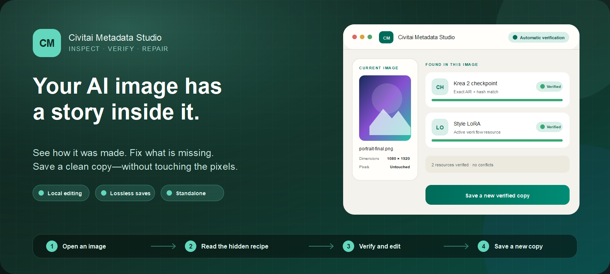

# Civitai Metadata Studio App Block

See the recipe inside an AI image. Read its prompt, seed, model and LoRA details, correct what needs fixing, and save a new copy with the same pixels.

[Project website](https://chriscollins500.github.io/civitai-metadata-studio-app-block/) · [Start using Studio](https://chriscollins500.github.io/civitai-metadata-studio-app-block/guide/#launch) · [Full standalone edition](https://github.com/chriscollins500/civitai-metadata-studio)



## Use the app

For your first visit, sign in to Civitai and choose **Apps → Browse the store**. Find **Civitai Metadata Studio** and choose **Open**. To return, look under **My apps** in the same browser. [Civitai.com App Store](https://civitai.com/apps/store) · [Civitai.red App Store](https://civitai.red/apps/store)

1. **Open a PNG, JPEG, or WebP.** The editor reads the settings and workflow information still inside the file.
2. **Review the recipe.** Check the prompt, seed, and resources. Open an exact Civitai model version when the editor can verify it.
3. **Save new copy.** Edit the metadata you want to change. The original file stays untouched. The copy keeps its encoded pixels and supported animation frames.

Opening and editing happen in your browser. On an explicit save, the Civitai page in that tab receives the finished file and its retained metadata to trigger the download. The first save explains this handoff. Use the full standalone edition for local downloads outside that page or for exports above the hosted limits. [Privacy and export limits](docs/Privacy-and-Exports.md) · [Download the standalone edition](https://github.com/chriscollins500/civitai-metadata-studio/releases/latest)

## Documentation

| Page | What you’ll find |
| --- | --- |
| [Getting started](docs/Getting-Started.md) | A first edit, public image import, and resource verification |
| [Privacy and exports](docs/Privacy-and-Exports.md) | What stays local, what crosses the host boundary, and file limits |
| [Troubleshooting](docs/Troubleshooting.md) | Missing metadata, uncertain matches, and downloads |
| [Architecture](docs/Architecture.md) | Shared engine, host bridge, and data flow |
| [Build and verify](docs/Build-and-Verify.md) | Commands, artifact layout, and test coverage |
| [Release provenance](docs/Release-Provenance.md) | Hashes for the live HTML and both package forms |
| [Maintainer guide](docs/Maintainer-Guide.md) | Preparing a release and reviewing changes |

[Browse the App Block wiki](https://github.com/chriscollins500/civitai-metadata-studio-app-block/wiki) · [Try the project website’s example](https://chriscollins500.github.io/civitai-metadata-studio-app-block/#example)

## Reproduce the release

Use Node.js 24 or later. The release was verified with the version recorded in [.node-version](.node-version). The build has no npm dependencies.

```sh
npm run reproduce
npm run verify:live
```

On `main`, the first command checks the signed GitHub v0.1.1 source and ZIP and rebuilds the recorded Civitai 0.1.2 HTML. The second compares that HTML byte for byte with the file currently served by Civitai. GitHub’s attestation verifies the immutable release tag, commit, and assets. [Build details](docs/Build-and-Verify.md) · [GitHub release record](releases/0.1.1.json) · [Hosted build record](releases/live.json) · [Verify the release](https://chriscollins500.github.io/civitai-metadata-studio-app-block/project/#release)

## Get involved

Report hosted-app problems here. Bring a small synthetic example when you can. The standalone project maintains its own downloads, wiki, and issue tracker. [Support](SUPPORT.md) · [Contributing](CONTRIBUTING.md) · [Security](SECURITY.md) · [Standalone wiki](https://github.com/chriscollins500/civitai-metadata-studio/wiki)

This project is MIT-licensed. The pinned Civitai manifest schema has a separate Apache-2.0 notice. [License](LICENSE) · [Third-party notices](app-block/THIRD-PARTY-NOTICES.md)
