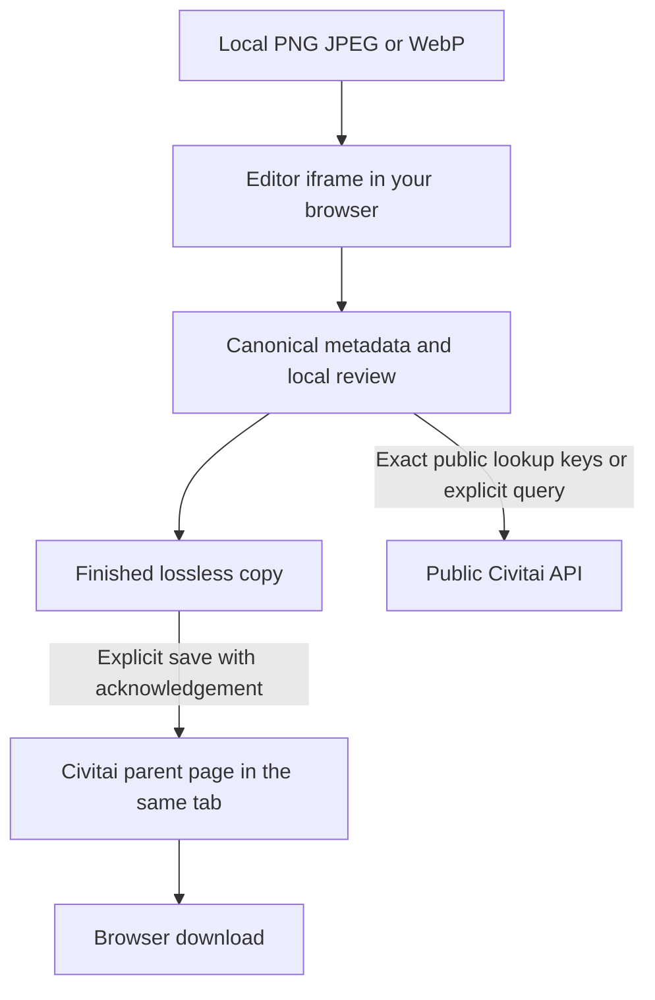

# Architecture

The hosted app and the fully featured standalone edition share a metadata engine. This repository keeps the exact source snapshot used to build the hosted release, including the shared modules it needs. The standalone project remains the upstream home of the shared engine. [Upstream baseline](Release-Provenance.md) · [Standalone source](https://github.com/chriscollins500/civitai-metadata-studio)

| Layer | Responsibility |
| --- | --- |
| [Shared formats](../src/formats) and [canonical record](../src/core/canonical.js) | Parse metadata, resolve field evidence, and rewrite metadata while preserving image payloads |
| [Identity client](../src/core/civitai.js) | Verify exact Civitai identity, keep conflicting candidates visible, and bound lookups |
| [App state](../src/app/state.js) | Edit records, preserve history, validate and prepare outputs |
| [Host bridge](../src/app-block/bridge.js) and [exporter](../src/app-block/exporter.js) | Allowlisted parent origins, request correlation, save acknowledgement, ZIP handling, and exact model navigation |
| [Manifest](../app-block/block.manifest.json) | Declared Civitai version, page, rating, iframe settings, and zero app scopes |

## Follow the bytes

The host bridge accepts the supported parent origins and rejects replies with the wrong window, origin, or request ID. The app uses a session cache in the sandboxed iframe. The reference lists are a dated pinned public snapshot because the live enums endpoint did not provide the CORS headers needed by the embedded browser client. On .com the client uses the host’s narrower public catalog rules. Local file editing uses the same engine on both sites.

The content security policy binds the inline script by hash. All runtime JavaScript and CSS are packaged into one HTML entry. The release archive contains that entry, its manifest, the license, and checksums. [Pinned protocol and reference sources](../app-block/protocol-provenance.json) · [Third-party notice](../app-block/THIRD-PARTY-NOTICES.md)

[Privacy and exports](Privacy-and-Exports.md) · [Build and verify](Build-and-Verify.md)
